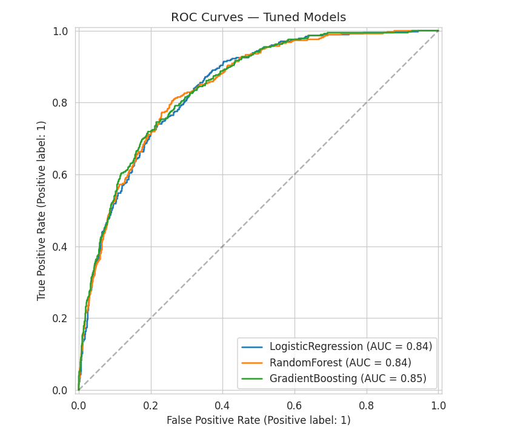
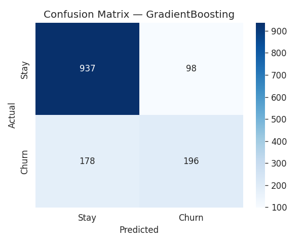
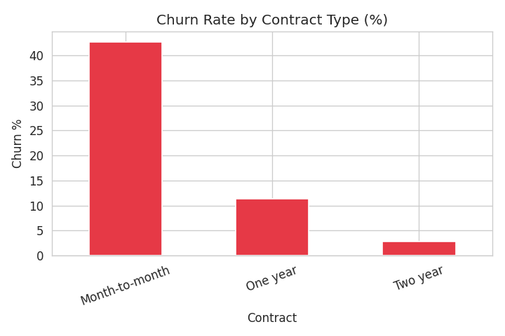
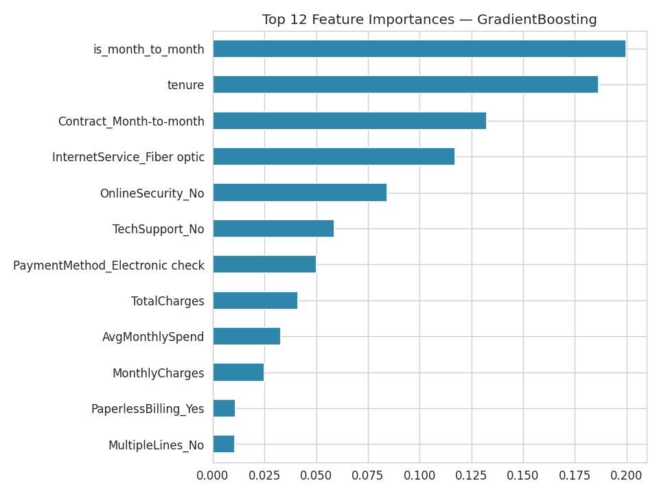

# End-to-End Customer Churn Prediction

A complete predictive-analytics pipeline that finds which telecom customers are likely to **churn** (cancel their service), so a business can offer retention deals before it loses them. It was built as Task 1 of the Business Intelligence track of an internship, using the public **IBM Telco Customer Churn** dataset (7,043 customers, 21 attributes).

## Results

Three models were tuned with `GridSearchCV` (5-fold stratified cross-validation, scored on ROC-AUC) and compared on a held-out 20% test set (1,409 customers):

| Model | Train accuracy | Test accuracy | Precision | Recall | F1 | ROC-AUC |
|---|---|---|---|---|---|---|
| Logistic Regression | 0.8097 | 0.7991 | 0.6532 | 0.5187 | 0.5782 | 0.8424 |
| Random Forest | 0.8257 | 0.8055 | 0.6761 | 0.5134 | 0.5836 | 0.8431 |
| **Gradient Boosting** (selected) | 0.8186 | 0.8041 | 0.6667 | 0.5241 | **0.5868** | **0.8461** |

The selected model (best ROC-AUC) finds about **52% of the customers who really churn**, and about two thirds of the customers it flags do churn:

| Class | Precision | Recall | F1 | Customers |
|---|---|---|---|---|
| Stay | 0.84 | 0.91 | 0.87 | 1,035 |
| Churn | 0.67 | 0.52 | 0.59 | 374 |

<p align="center">
  
  
</p>

## What the pipeline does

1. **Data collection.** Loads the Telco churn data (`data/telco_churn.csv`).
2. **Data cleaning.**
   - `TotalCharges` is stored as text and holds 11 blank values. All 11 belong to customers with `tenure == 0` (new customers not yet billed), so they are set to 0 instead of being dropped.
   - `customerID` is removed because it carries no information.
   - The target is imbalanced (about 26.5% churn), so accuracy alone is not trusted: precision, recall, F1 and ROC-AUC are tracked too.
3. **Exploratory analysis.** Class balance, tenure and monthly charges against churn, and churn by contract type.
4. **Feature engineering.** Six features built from telecom domain knowledge: `AvgMonthlySpend`, `tenure_group`, `num_services`, `has_internet`, `is_month_to_month` and `auto_payment`.
5. **Preprocessing pipeline.** One scikit-learn `Pipeline` (standard scaling for numbers, one-hot encoding for categories) so the same steps run in training and prediction. Stratified 80/20 split (5,634 train and 1,409 test rows).
6. **Overfitting demonstration.** An unconstrained decision tree reaches 99.8% training accuracy but only 72.8% on the test set (a 27-point gap); an unconstrained random forest reaches 99.8% and 78.0%. This shows why the tuned, regularised models are used.
7. **Hyperparameter tuning and evaluation** (table above), then the selected model is saved with `joblib` and its top 12 feature importances are plotted.
8. **Business insights and two written design answers** at the end of the notebook: why a model can show 99% training but 74% test accuracy, and how to redesign the workflow for 50 million records.

<p align="center">
  
  
</p>

## Main findings

- **Contract type is the strongest signal.** Month-to-month customers churn at 42.7%, one-year contracts at 11.3% and two-year contracts at 2.8%.
- **The first year is the riskiest.** Churn falls steadily as tenure grows, so early engagement (onboarding calls, first-90-day offers) matters most.
- **Fiber-optic customers churn more than DSL customers**, although they pay more, which points to a price or service-quality question.
- **Customers without add-ons** such as online security or tech support churn more, so bundling them at signup is worth testing.

## Project layout

```text
notebooks/churn_predictive_analytics.ipynb   the full analysis
data/telco_churn.csv                         raw IBM Telco Customer Churn data
outputs/                                     cleaned data and the charts the notebook produces
report/Final_Report_Churn_Prediction.docx    written project report
requirements.txt                             Python packages
```

## Run it

```bash
python -m venv venv
venv\Scripts\activate            # macOS/Linux: source venv/bin/activate
pip install -r requirements.txt
jupyter notebook notebooks/churn_predictive_analytics.ipynb
```

The notebook reads `../data/telco_churn.csv` and writes its files to `../outputs/`, so open it from the `notebooks/` folder. Running it also creates `outputs/best_model.joblib` (the trained model), which is not stored in this repository.

## Limitations

- The model misses about half of the real churners (recall 0.52 at the default 0.5 threshold). A lower threshold would catch more of them at the cost of more false alarms; the threshold was not tuned.
- The data is one snapshot of a customer base, not a time series, so it cannot show how churn changes over time.
- The results come from a single train/test split with a fixed random seed.
- Churn is only predicted, not explained causally: a finding such as "month-to-month customers churn more" is a pattern in the data, not proof that a contract offer would change behaviour.
